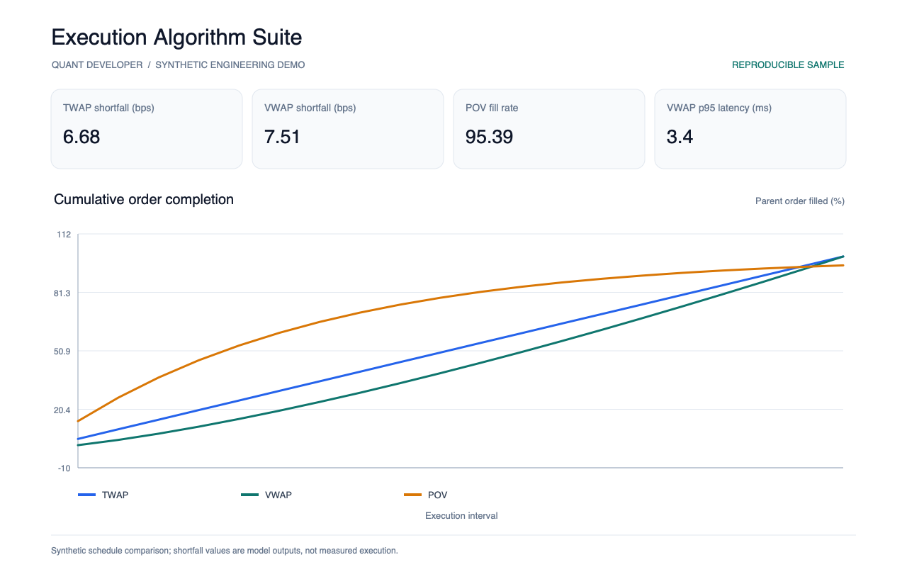
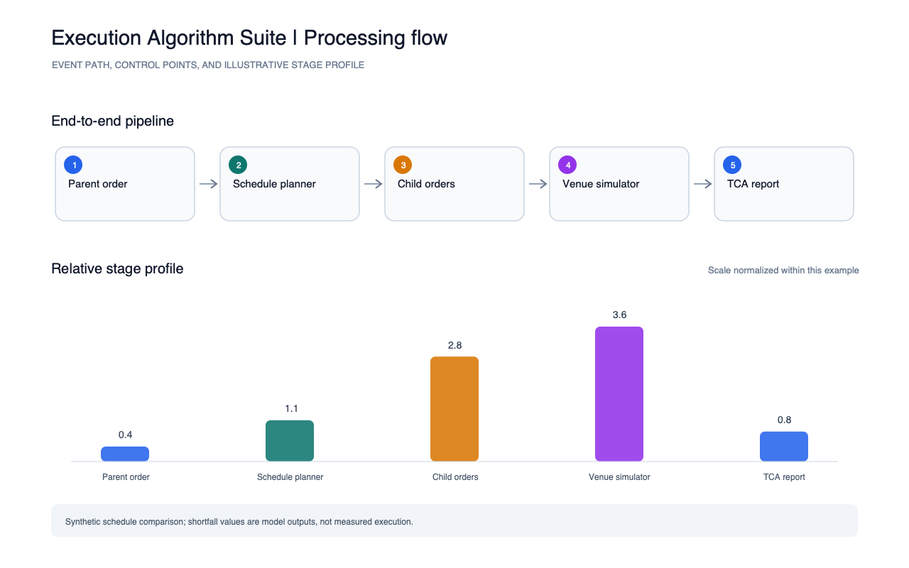

# Execution Algorithm Suite

A small parent-order schedule comparison for TWAP, VWAP-shaped, and participation-of-volume (POV) execution. The deterministic price path is intentionally synthetic.

Run `python3 run.py` to write implementation-shortfall, fill-rate, child-order latency, and participation summaries to `reports/metrics.json`. Run `python3 ../run_all.py` at the portfolio root to refresh all figures.

The schedule comparison is an educational simulation, not measured execution quality or a broker benchmark.
